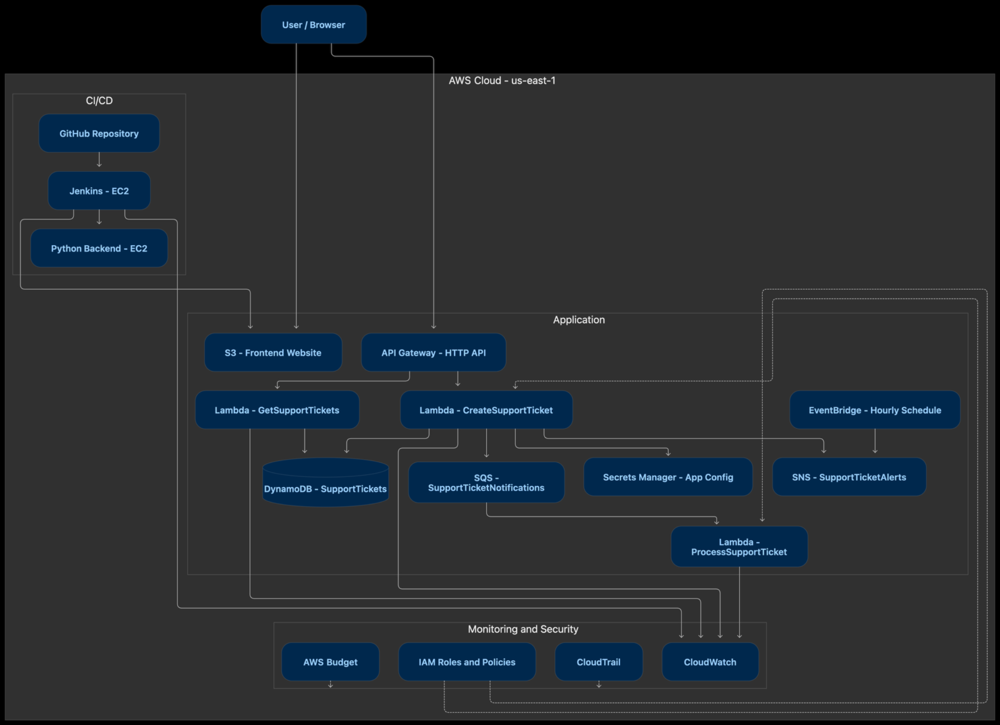

# AWS Serverless Support Ticket Management System

## 1. Project Overview

This project is an AWS-based Support Ticket Management System built using serverless and cloud services.

Users can submit support tickets through a web interface. The application stores ticket information in DynamoDB and uses AWS messaging services to process notifications.

The project also includes a Jenkins CI/CD pipeline that automatically validates and deploys frontend updates to Amazon S3 and backend updates to an EC2 instance whenever code is pushed to GitHub.

## 2. AWS Architecture

### Architecture flow

- Users access the frontend hosted on Amazon S3.
- Amazon API Gateway receives HTTP requests.
- AWS Lambda processes ticket creation and retrieval.
- Amazon DynamoDB stores ticket information.
- Amazon SQS handles asynchronous ticket notification messages.
- A separate Lambda function processes SQS messages.
- Amazon SNS sends email notifications.
- Amazon EventBridge triggers scheduled hourly notifications.
- AWS Secrets Manager stores application configuration.
- Jenkins automates frontend and backend deployment.
- Amazon CloudWatch monitors application activity.
- AWS CloudTrail records account activity.

### Architecture diagram



## 3. AWS Services Used

| Service | Purpose |
|---|---|
| Amazon S3 | Frontend website hosting and deployment |
| API Gateway | HTTP API endpoints |
| AWS Lambda | Ticket creation, retrieval and message processing |
| DynamoDB | Ticket database |
| SQS | Asynchronous message queuing |
| SNS | Email notifications |
| EventBridge | Scheduled notifications |
| Secrets Manager | Secure application configuration |
| IAM | Access management and permissions |
| EC2 | Jenkins server and Python backend |
| Jenkins | CI/CD automation |
| CloudWatch | Application logs, monitoring and alarms |
| CloudTrail | AWS account audit logging |
| VPC | Network isolation and routing |
| AWS Budgets | Cost monitoring |

## 4. Application Details

**AWS Region:** `us-east-1`

**Frontend website:**

http://support-ticket-frontend-mukesh-2026.s3-website-us-east-1.amazonaws.com

**API Gateway:**

https://l51zpbva13.execute-api.us-east-1.amazonaws.com

### API endpoints

| Method | Endpoint | Purpose |
|---|---|---|
| POST | `/tickets` | Create a support ticket |
| GET | `/tickets` | Retrieve support tickets |

### DynamoDB

- Table name: `SupportTickets`
- Partition key: `ticketId`
- Capacity mode: On-demand

### Lambda functions

**CreateSupportTicket**
- Receives ticket information from API Gateway.
- Stores ticket information in DynamoDB.
- Sends notification messages to SQS.
- Publishes notifications to SNS.
- Retrieves configuration from Secrets Manager.

**GetSupportTickets**
- Retrieves ticket records from DynamoDB.
- Returns ticket information through API Gateway.

**ProcessSupportTicket**
- Triggered by messages from SQS.
- Processes queued ticket notifications.
- Writes processing information to CloudWatch logs.

### SQS and SNS

- Created SQS queue `SupportTicketNotifications`.
- Configured SQS event source mapping to `ProcessSupportTicket`.
- Configured batch size of 10.
- Created SNS topic `SupportTicketAlerts`.
- Configured and confirmed email subscription.

### Secrets Manager

- Created secret `SupportTicketAppConfig`.
- Stored application configuration.
- Configured Lambda to retrieve the secret using its ARN.
- Verified secret retrieval through CloudWatch logs.

## 5. CI/CD Pipeline

**GitHub repository:**

https://github.com/Mukesh-ph-git/aws-serverless-support-ticket-system

### Jenkins jobs

- `SupportTicket-Pipeline`
- `SupportTicket-Freestyle-Build`

### Pipeline stages

1. Checkout source code from GitHub.
2. Validate frontend files.
3. Validate backend files.
4. Execute build stage.
5. Deploy frontend files to Amazon S3.
6. Deploy Python backend to EC2.
7. Restart the backend systemd service.
8. Verify backend health endpoint.

### Deployment commands

**Frontend deployment:**

```bash
aws s3 sync frontend/ s3://support-ticket-frontend-mukesh-2026/ --delete
```

**Backend deployment:**

```bash
cp backend/app.py /opt/support-ticket-backend/app.py
sudo /usr/bin/systemctl restart support-ticket-backend
curl -fsS http://127.0.0.1:5000/health
```

### GitHub webhook

- Configured GitHub push webhook.
- Connected the webhook to Jenkins.
- Verified successful webhook deliveries with HTTP 200.
- Verified automatic Jenkins pipeline execution.

### EC2 backend

- Created a Python HTTP server on EC2.
- Configured backend service on port `5000`.
- Created systemd service `support-ticket-backend`.
- Enabled automatic service startup and restart.
- Verified the `/health` endpoint.
- Integrated backend deployment into Jenkins.

**Backend health endpoint:**

`http://44.211.54.51:5000/health`

**Note:** The EC2 Python backend currently provides a health-check endpoint. Ticket creation and retrieval are handled by API Gateway and Lambda.

The Jenkins EC2 instance uses an IAM role for S3 deployment without storing permanent AWS access keys.

## 6. VPC and Networking

- Created VPC `SupportTicketVPC`.
- Configured CIDR `10.0.0.0/16`.
- Created public subnet `SupportTicketPublicSubnet`.
- Created private subnet `SupportTicketPrivateSubnet`.
- Created and attached Internet Gateway `SupportTicketIGW`.
- Configured public route table `SupportTicketPublicRT`.
- Configured private route table `SupportTicketPrivateRT`.
- Associated the respective subnets with their route tables.
- Created security group `SupportTicketJenkinsSG`.
- Restricted Jenkins and backend access through security group rules.

**Note:** No NAT Gateway was created to avoid additional costs.

## 7. Monitoring and Security

- Created CloudWatch alarm `CreateSupportTicket-Lambda-Errors`.
- Configured alarm threshold for Lambda errors.
- Verified CloudWatch alarm state as OK.
- Used CloudWatch Logs to inspect Lambda executions.
- Created CloudTrail trail `SupportTicketAuditTrail`.
- Enabled multi-region CloudTrail logging.
- Enabled log file validation.
- Configured IAM roles and policies for AWS service access.
- Configured Jenkins EC2 IAM role for S3 deployment.
- Created AWS Budget `SupportTicketProjectBudget`.
- Configured a monthly budget of $10.
- Configured budget alerts at 50%, 80%, and 100%.

## 8. Testing Performed

| Test | Result |
|---|---|
| Frontend website access | Successful |
| Support ticket creation | Successful |
| Ticket retrieval | Successful |
| DynamoDB ticket storage | Verified |
| SQS message delivery | Verified |
| SQS-triggered Lambda processing | Successful |
| SNS email subscription | Confirmed |
| Secrets Manager retrieval | Verified |
| EC2 backend health check | Successful |
| GitHub webhook trigger | HTTP 200 |
| Jenkins pipeline execution | Successful |
| Automatic S3 frontend deployment | Successful |
| Automatic EC2 backend deployment | Successful |
| CloudWatch alarm | OK |
| CloudTrail logging | Active |

## 9. Future Improvements

- Configure CloudFront CDN after AWS account verification.
- Add HTTPS using CloudFront.
- Implement authentication and authorization.
- Expand the EC2 Python backend if additional application functionality is required.
- Add automated unit and integration tests.
- Enable SSE-KMS encryption for CloudTrail log storage.
- Improve monitoring dashboards and reporting.

## 10. Conclusion

This project demonstrates the implementation of an AWS-based Support Ticket Management System with serverless application services and automated CI/CD deployment.

It combines AWS Lambda, API Gateway, DynamoDB, SQS, SNS, Secrets Manager, EC2, Jenkins, VPC networking, IAM, CloudWatch, CloudTrail and AWS Budgets.

The GitHub-to-Jenkins pipeline successfully deploys frontend files to Amazon S3 and the Python backend to EC2, followed by a health check.

**Project Status:** Core application and CI/CD deployment workflow completed and tested.

**AWS Region:** `us-east-1`

**GitHub Repository:** https://github.com/Mukesh-ph-git/aws-serverless-support-ticket-system
