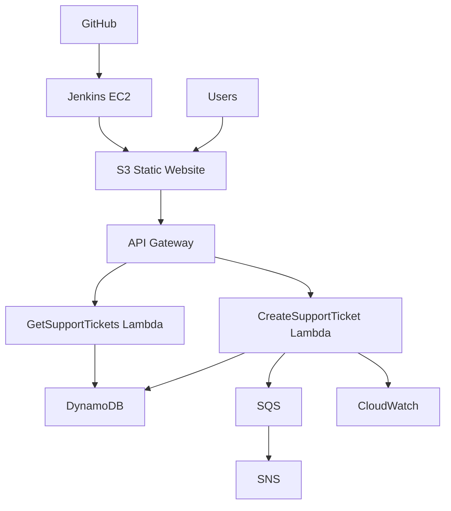

# AWS Serverless Support Ticket Management System

## 1. Project Overview

This project is a serverless Support Ticket Management System built using AWS services. Users can submit support tickets through a web interface, store ticket information, and receive notifications through AWS messaging services.

The project also includes a Jenkins CI/CD pipeline that automatically validates and deploys frontend updates to Amazon S3 whenever code is pushed to GitHub.

## 2. AWS Architecture

### Architecture flow

- Users access the frontend hosted on Amazon S3.
- Amazon API Gateway receives HTTP requests.
- AWS Lambda processes ticket creation and retrieval.
- Amazon DynamoDB stores ticket information.
- Amazon SQS handles ticket notification messages.
- Amazon SNS sends email notifications.
- Amazon CloudWatch monitors Lambda errors.
- AWS CloudTrail records account activity.
- Jenkins automates frontend validation and deployment.

### Architecture diagram



## 3. AWS Services Used

| Service | Purpose |
|---|---|
| Amazon S3 | Frontend hosting and deployment |
| API Gateway | REST API endpoints |
| AWS Lambda | Backend processing |
| DynamoDB | Ticket database |
| SQS | Message queuing |
| SNS | Email notifications |
| IAM | Access management |
| EC2 | Jenkins server |
| Jenkins | CI/CD automation |
| CloudWatch | Monitoring and alarms |
| CloudTrail | Audit logging |
| EventBridge | Scheduled notifications |
| VPC | Network isolation |
| AWS Budgets | Cost monitoring |

## 4. Application Details

**AWS Region:** us-east-1

**Frontend website:**

http://support-ticket-frontend-mukesh-2026.s3-website-us-east-1.amazonaws.com

**API Gateway:**

https://l51zpbva13.execute-api.us-east-1.amazonaws.com

### API endpoints

| Method | Endpoint | Purpose |
|---|---|---|
| POST | /tickets | Create a support ticket |
| GET | /tickets | Retrieve support tickets |

### DynamoDB

Table name: `SupportTickets`

Partition key: `ticketId`

### Lambda functions

- `CreateSupportTicket`
- `GetSupportTickets`

## 5. CI/CD Pipeline

GitHub repository:

https://github.com/Mukesh-ph-git/aws-serverless-support-ticket-system

Jenkins jobs:

- SupportTicket-Pipeline
- SupportTicket-Freestyle-Build

### Pipeline stages

1. Checkout source code from GitHub.
2. Validate frontend files.
3. Execute build stage.
4. Deploy frontend files to Amazon S3.

### Deployment command

```bash
aws s3 sync frontend/ \
s3://support-ticket-frontend-mukesh-2026/ --delete
```

GitHub push events automatically trigger Jenkins builds through a webhook.

The Jenkins EC2 instance uses an IAM role for S3 deployment without storing permanent AWS access keys.

## 6. Monitoring and Security

- CloudWatch alarm monitors Lambda errors.
- CloudTrail records management events.
- IAM roles provide controlled AWS permissions.
- S3 bucket policy allows public website access.
- Jenkins server access is restricted through security group rules.
- AWS Budget monitors monthly spending.

## 7. Testing Performed

- Frontend website access verified.
- Support ticket creation tested.
- Ticket retrieval tested.
- SQS message delivery verified.
- SNS email notification tested.
- Lambda monitoring alarm verified.
- Jenkins pipeline build successful.
- GitHub webhook push trigger verified.
- Automatic S3 frontend deployment verified.

## 8. Future Improvements

- Configure CloudFront CDN after AWS account verification.
- Add HTTPS using CloudFront.
- Add authentication and authorization.
- Improve backend deployment automation.
- Add more detailed monitoring and reporting.

## 9. Conclusion

This project demonstrates the implementation of an AWS-based serverless application with automated frontend deployment using GitHub and Jenkins.

It combines serverless computing, database management, messaging, monitoring, auditing, IAM security, and CI/CD automation.
